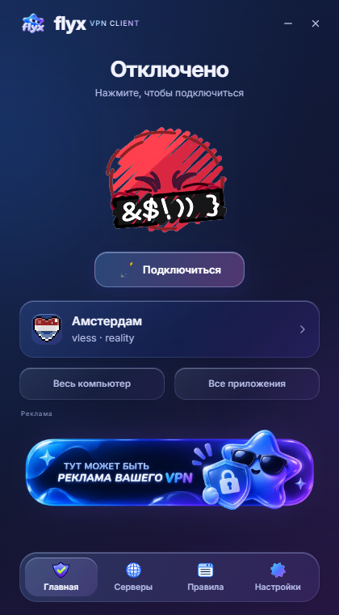
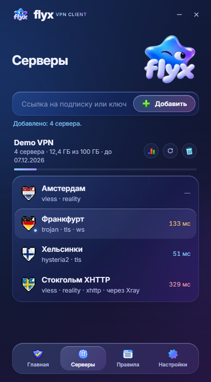
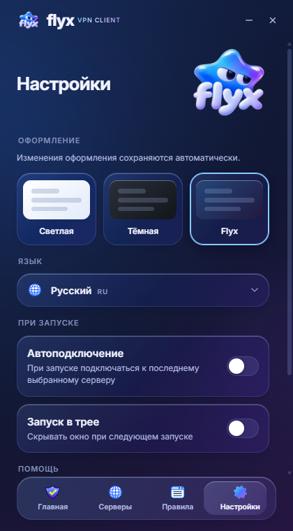

# Flyx

VPN-клиент с интерфейсом liquid glass для Windows и Linux. Экспериментальная версия для Android.

Flyx работает **с вашими подписками и ключами**; приложение не предоставляет собственные VPN-серверы.

[Скачать релиз](https://github.com/sams843586-oss/flyx/releases/latest) · [Telegram](https://t.me/flyxclient) · [Сообщить об ошибке](https://github.com/sams843586-oss/flyx/issues)

## Интерфейс

<p align="center">  </p>

## Возможности

- Подписки, импорт ключей и совместимые конфигурации VLESS, VMess, Trojan, Shadowsocks, Hysteria2 и TUIC.
- sing-box и Xray: в том числе VLESS Reality и XHTTP в поддерживаемых ядрами вариантах.
- Системный VPN или локальный прокси на настольных системах.
- Правила для приложений и доменов, каталог российских сервисов для прямого доступа.
- Три темы, девять языков, персидская раскладка справа налево.
- Анимированные флаги, стикеры и персонаж Flyx; анимации останавливаются в фоне.
- Трей и автоподключение на настольных системах.
- Проверка GitHub Releases и установка подписанных обновлений на Windows/Linux.

Совместимость зависит от протокола, транспорта и требований провайдера. Неподдерживаемые записи пропускаются с пояснением. Kill Switch пока не реализован. Правила прямого доступа отправляют совпавший трафик вне VPN.

## Скачать и установить

| Система | Файл | Статус |
|---|---|---|
| Windows 10/11 x64 | `Flyx_0.1.1_x64-setup.exe` | Первый публичный выпуск |
| Ubuntu 24.04+ / Debian 12+, x64 | `flyx-vpn_0.1.1_amd64.deb` | Экспериментальный; требуется проверка на Linux |
| Android 10+, arm64 | `Flyx-0.1.0-android-arm64.apk` | Alpha; требуется проверка на телефоне |

**Windows:** запускайте установщик из релиза. Он содержит приложение, службу и оба ядра, регистрирует службу и добавляет деинсталлятор. Потребуются права администратора. Если WebView2 отсутствует, установщик предложит установить его; для загрузки Runtime нужен интернет. Отдельный EXE приложения не заменяет установщик.

**Linux:** [установка, группа доступа и диагностика](LINUX.md). Графическое окно запускайте без sudo.

**Android:** [установка, устройство VPN и ограничения](ANDROID.md). Нужна системная VPN-разрешение; root не требуется.

## Обновления

Flyx проверяет новые версии при запуске. Раздел «Настройки → Обновления» позволяет проверить вручную. Обновление загружается по HTTPS и проверяется закреплённым публичным ключом Minisign. Только после проверки запускается установка. Windows использует NSIS, Linux — пакет .deb через polkit/dpkg. Установка временно прерывает VPN. На Android кнопка открывает страницу релиза с APK.

Подпись пакета обновления и сертификат издателя Windows — разные механизмы; текущий выпуск не имеет Authenticode-сертификата. Приватные ключи подписи в репозитории не хранятся.

## Сборка

Rust stable, Python 3. Графический клиент — Tauri 2, интерфейс — локальные HTML/CSS/JS без CDN.

Windows: установите стандартные зависимости Tauri и NSIS через Tauri CLI; затем:

```powershell
./tools/build-windows.ps1
```

Для подписанных артефактов задайте `TAURI_SIGNING_PRIVATE_KEY` и `TAURI_SIGNING_PRIVATE_KEY_PASSWORD`. Скрипт проверяет тесты, собирает службу/клиент, загружает закреплённые ядра и создаёт NSIS-инсталлятор. Результат: `output/Release`.

Linux:

```bash
bash tools/build-linux.sh
```

Зависимости и инструкции — [LINUX.md](LINUX.md). Для Android — [ANDROID.md](ANDROID.md).

## Код

- `crates/core` — разбор подписок, модель сервера и конфигурации ядер.
- `crates/app` — настольное окно и подписанные обновления.
- `crates/service` — Windows-служба / Linux systemd daemon.
- `crates/cli` — консольный клиент.
- `crates/wasm` — общий Rust-парсер для Android.
- `ui` — интерфейс, локализация и локальные ресурсы.
- `android` — WebView Activity и foreground VPN Service.
- `packaging` — установщики, закреплённые версии и SHA256 ядер.

В репозиторий не включены подписки пользователей, конфиги с ключами, signing keys, готовые бинарные файлы, результаты сборки и исходные архивы/музыка автора.

## Лицензия

Код — [GPL-3.0](LICENSE). [Сторонние компоненты и материалы](THIRD_PARTY_NOTICES.md).

### Windows service installation

The GUI can be installed in a custom directory. The installer keeps the privileged
service and both VPN cores in the native `Program Files\FlyxService` directory,
resolved through the Windows Known Folders API. Uninstall removes the service and
its managed files while preserving user subscriptions and preferences. Installation
failures are written in UTF-8 to `Program Files\FlyxService\install-error.log`.
